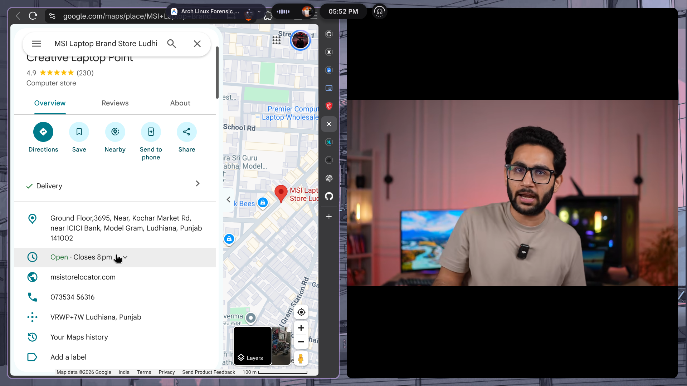
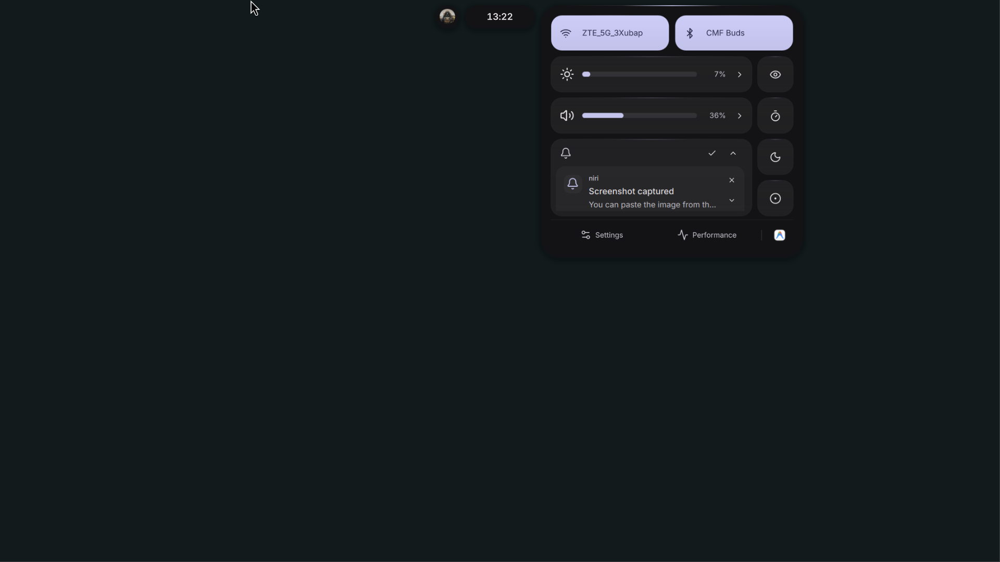
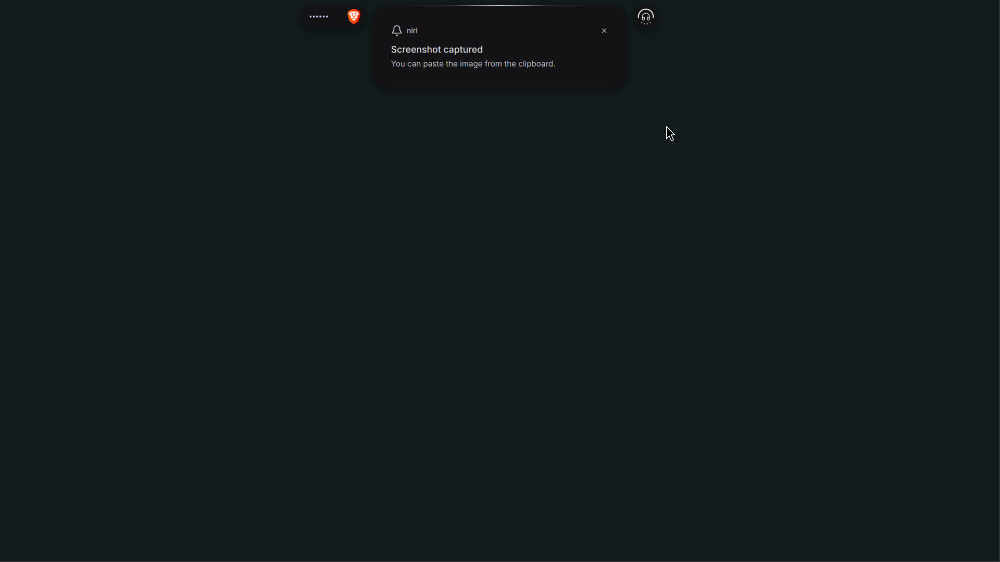
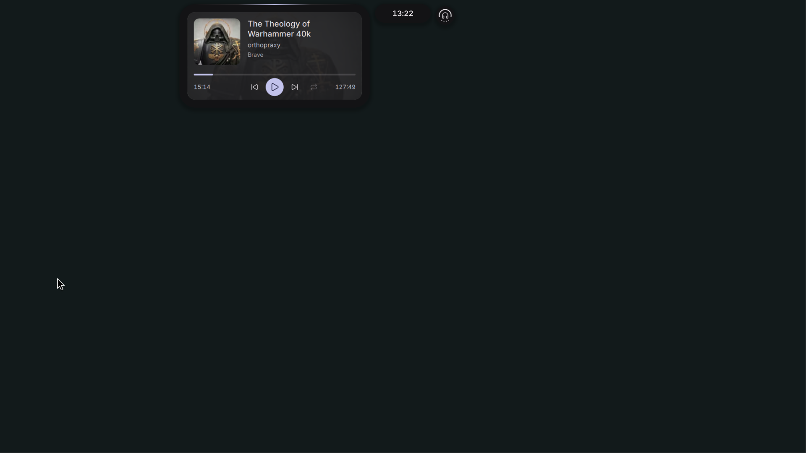
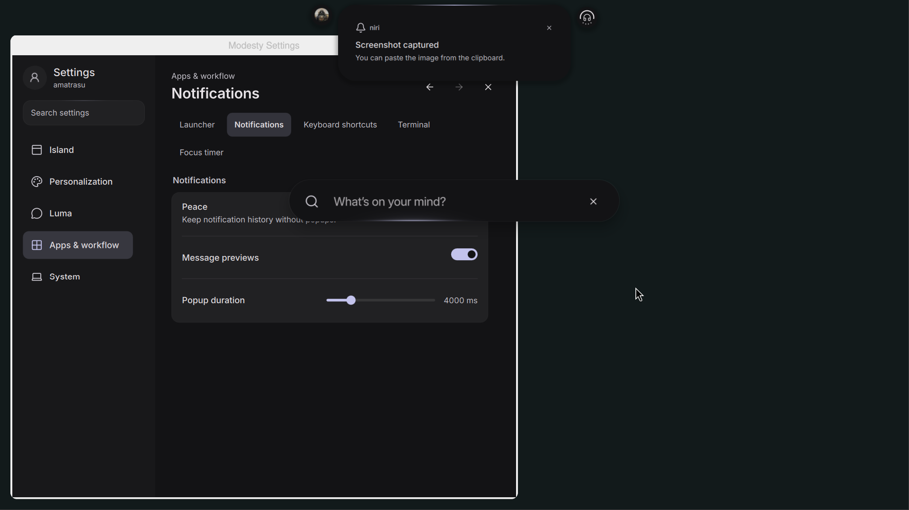
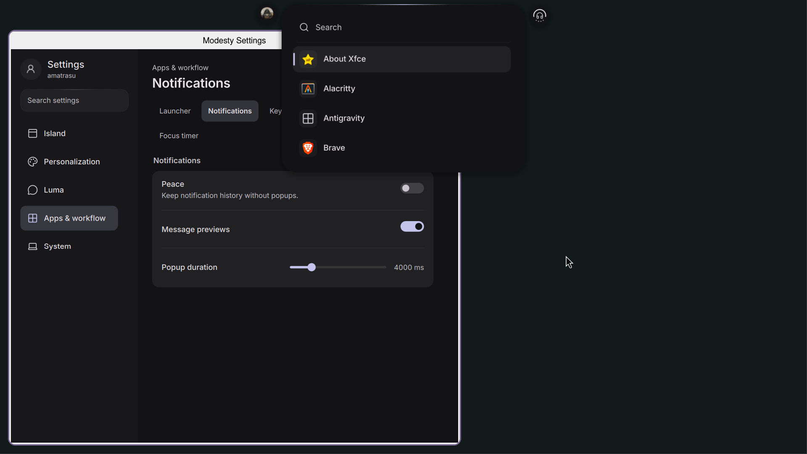

# arch-files: Reproducible Arch Linux Configuration & Modular Deployment

[](https://archlinux.org)
[](https://github.com/YaLTeR/niri)
[-89b4fa)](https://github.com/sandeepbist/Modesty)
[](https://github.com/catppuccin/catppuccin)
[](docs/DEPLOYMENT_SIMULATION_REPORT.md)
[](LICENSE)

A complete, forensic-grade, reproducible Arch Linux configuration and automated deployment project. Built on top of **Niri** (scrollable-tiling Wayland compositor) and **Modesty** (Dynamic Island QtQuick shell), styled in **Catppuccin Mocha** with Mauve accents.

Designed for automated inspection and deployment by human users or autonomous AI coding agents.

---

## Table of Contents
1. [Project Overview](#1-project-overview)
2. [Desktop Screenshots](#2-desktop-screenshots)
3. [Feature Overview](#3-feature-overview)
4. [Hardware & Software Requirements](#4-hardware--software-requirements)
5. [Architecture & Repository Structure](#5-architecture--repository-structure)
6. [Profile Comparison](#6-profile-comparison)
7. [Installation Instructions](#7-installation-instructions)
8. [Module-Specific Deployment](#8-module-specific-deployment)
9. [Backup, Restore & Uninstallation](#9-backup-restore--uninstallation)
10. [Customization Guidelines](#10-customization-guidelines)
11. [Hardware-Specific Limitations](#11-hardware-specific-limitations)
12. [Known Issues & Testing Status](#12-known-issues--testing-status)
13. [Upstream Credits & Licenses](#13-upstream-credits--licenses)
14. [Contributing](#14-contributing)

---

## 1. Project Overview

`arch-files` is not simply a static dotfiles backup. It is a structured, declarative, and automated deployment framework that turns an existing Arch Linux configuration into a reproducible desktop distribution. 

### Core Capabilities
* **100% Path Portability**: Zero hardcoded user directories. All configurations and user systemd service units dynamically adapt to `$PATH`, `$USER_HOME`, and `%h`.
* **Declarative Profiles**: Three distinct deployment profiles (`default`, `minimal`, `development`) tailored for varying workflow and hardware needs.
* **Modular Execution**: 13 independently executable deployment modules with dry-run verification and automatic collision handling.
* **Modesty Dynamic Island Integration**: Complete automated pipeline for upstream cloning, commit pinning (`690af8b`), patch application (`modesty-customizations.patch`), and integration of 11 custom components.
* **Zero-Risk Rollback**: Automatic pre-deployment snapshots and SHA256-verified rollback tools ensure that existing setups can be restored safely.

---

## 2. Desktop Screenshots

The desktop environment combines Niri's infinite scrollable tiling strip with Modesty's interactive dynamic island.

| Desktop Overview | Control Center |
| :---: | :---: |
|  |  |
| *Niri scrollable workspace with Modesty Dynamic Island and laundry.jpg wallpaper* | *Full quick settings panel (Wi-Fi, Bluetooth, Audio, Display, and Power)* |

| Dynamic Island Hovered | Media Player Card |
| :---: | :---: |
|  |  |
| *Hovered expansion with quick media and status toggles* | *Expanded MPRIS media card with progress bar and album controls* |

| Command Canvas (Raycast-Style) | Application Launcher (Fuzzel) |
| :---: | :---: |
|  |  |
| *Modesty Spotlight-style universal search & action canvas* | *Fuzzel categorized fuzzy-search application launcher* |

*For a full catalog of all 23 verified desktop screenshots, see [docs/SCREENSHOT_CATALOG.md](docs/SCREENSHOT_CATALOG.md).*

---

## 3. Feature Overview

* **Compositor**: **Niri 26.04**
  * Infinite horizontal scrollable tiling strip.
  * Windows open in columns; columns can be resized, stacked, or expanded dynamically.
  * Custom focus ring styled in Catppuccin Mauve (`#cba6f7`) with smooth CSS animations.
* **Desktop Shell**: **Modesty** (powered by **QuickShell / QtQuick / QML**)
  * Collapsed pill idle state dynamically expanding on hover or events.
  * Control Center submenus: Wi-Fi (`nmcli`), Bluetooth (`bluetoothctl`), Sound (`pipewire`/`wireplumber`), Display scaling, and Power controls.
  * AI Agent Pill module (`AiAgentPill.qml`) with real-time status reporting (`ai-agent-status.py`).
  * Unified shortcut synchronization service (`sync_shortcuts.py`) mapping active Niri keybindings into an on-screen reference modal (`ShortcutReference.qml`).
* **Terminal**: **Kitty 0.49**
  * Glassmorphism with `background_opacity 0.82` and `background_blur 1`.
  * Catppuccin Mocha color scheme with custom cursor trails.
* **Application Launcher**: **Fuzzel 1.15** & Modesty Command Canvas.
* **Audio Stack**: **PipeWire 1.6** with WirePlumber, PulseAudio bridge, ALSA compatibility, and Cava audio visualizer.
* **Lock Screen & Security**: **Swaylock** with Wayland session lock protocol (`ext-session-lock-v1`) and custom wallpaper backdrop.
* **Session Inactivity Management**: Multi-tier idle policy:
  * 10 minutes: Lock session via Swaylock.
  * 1 hour: System suspend.
  * 6 hours: Clean system poweroff.
* **File Management**: **Thunar 4.20** with custom user actions (open in terminal, compress) and GTK styling.
* **Default Web Browser**: **Brave Browser** with hardware VA-API video decoding flags and Wayland Ozone flags enabled.

---

## 4. Hardware & Software Requirements

### Target Hardware (Reference Environment)
The reference configuration was developed and extracted from a **Lenovo ThinkPad E560**:
* **CPU**: Intel Core i5-6200U (Skylake-U, 2.30 GHz)
* **GPU**: Intel HD Graphics 520 (Skylake GT2, `i915` kernel driver)
* **RAM**: 8 GB DDR3L (zram swap with zstd compression enabled)
* **Display**: 1920x1080 @ 60Hz via `HDMI-A-1` (Scale factor: 1.4x)

### Minimum Requirements for Deployment
* **Architecture**: x86_64
* **Operating System**: Arch Linux (rolling release, updated)
* **Display Server**: Pure Wayland (no X11 display server needed; `xwayland-satellite` provides seamless X11 fallback)
* **Graphics Driver**: Mesa with Wayland DRM/KMS support (Intel `vulkan-intel`, AMD `vulkan-radeon`, or NVIDIA with `nvidia-open`)
* **Audio**: PipeWire & WirePlumber

*For comprehensive hardware adaptation guidelines across Intel, AMD, and NVIDIA, see [docs/HARDWARE.md](docs/HARDWARE.md).*

---

## 5. Architecture & Repository Structure

```
arch-files/
├── AGENTS.md                  # Comprehensive AI-Agent deployment & execution manual
├── README.md                  # Main release candidate documentation
├── LICENSE                    # MIT License for repository code and automation
├── SECURITY.md                # Security policy & data sanitization guarantees
├── CONTRIBUTING.md            # Guidelines for community contributions
├── docs/                      # 23 forensic audit, architecture, profile & test documents
│   ├── DEPLOYMENT_SIMULATION_REPORT.md # Isolated simulation test results (100% pass rate)
│   ├── PROFILES.md            # In-depth profile comparison & package lists
│   ├── MODULES.md             # 13 deployment modules catalog & symlink maps
│   ├── THIRD_PARTY_LICENSES.md# Detailed third-party licenses & upstream attribution
│   ├── HARDWARE.md            # Hardware inventory & GPU adaptation specs
│   ├── KEYBINDINGS.md         # Comprehensive keyboard shortcuts reference
│   ├── SCREENSHOT_CATALOG.md  # Index of 23 visual desktop screenshots
│   └── TROUBLESHOOTING.md     # Common issues, display fixes, and recovery steps
├── configs/                   # Sanitized configuration files & assets
│   ├── niri/config.kdl        # Niri compositor layout & keybindings
│   ├── terminal/kitty.conf    # Kitty glassmorphic terminal
│   ├── launcher/fuzzel.ini    # Fuzzel application launcher
│   ├── gtk/                   # GTK 3 & 4 Catppuccin themes + 68 symbolic SVG icons
│   ├── shell/                 # Zsh, Bash configurations, and gitconfig template
│   ├── lockscreen/            # Swaylock configuration & lock-session helper
│   ├── file-manager/          # Thunar custom actions and accelerators
│   ├── browsers/              # Brave flags (hardware VA-API) & MIME associations
│   └── misc/                  # Environment.d, XDG portals, systemd units, helper binaries
├── packages/                  # Machine-readable package groups & inventories
├── profiles/                  # Machine-readable profile manifests (default, minimal, development)
├── scripts/                   # Modular automation framework
│   ├── lib/                   # Common logging, paths, symlinks, packages, backup libraries
│   ├── modules/               # 13 dedicated, independently executable deployment modules
│   ├── bootstrap.sh           # System prerequisite & AUR helper bootstrapper
│   ├── install.sh             # Package installer based on profile manifests
│   ├── configure.sh           # Modular configuration orchestrator (--profile, --module, --dry-run)
│   ├── backup.sh              # Pre-deployment safety backup
│   ├── restore.sh             # Safety rollback tool
│   ├── uninstall.sh           # Safe uninstaller with dry-run protection
│   └── validate.sh            # Automated syntax, JSON, Niri, systemd, assets validator
├── system/                    # System-level configuration templates (/etc, pacman, zram)
├── themes/                    # Catppuccin Mocha palette specifications
├── upstream/                  # Upstream projects, patches & custom additions
│   └── modesty/               # Complete Modesty customization package (patch + 11 additions)
└── assets/                    # 23 verified screenshots & desktop wallpapers
```

---

## 6. Profile Comparison

`arch-files` offers three distinct, machine-readable installation profiles:

| Feature / Dimension | Minimal (`minimal`) | Default (`default`) | Development (`development`) |
| :--- | :--- | :--- | :--- |
| **Intended Use** | Testing, low-RAM, or headless minimal | Full daily driver desktop | Full-stack & mobile developers |
| **Compositor** | Niri 26.04 | Niri 26.04 | Niri 26.04 |
| **Desktop Shell** | None (pure window manager) | Modesty (Dynamic Island QuickShell)| Modesty (Dynamic Island QuickShell)|
| **Terminal** | Kitty | Kitty | Kitty |
| **Launcher** | Fuzzel | Fuzzel + Modesty App Launcher | Fuzzel + Modesty App Launcher |
| **File Manager** | None (CLI tools) | Thunar (XFCE) + custom actions | Thunar (XFCE) + custom actions |
| **Web Browser** | None | Brave Browser (`brave-bin`) | Brave, Helium, and Zen Browsers |
| **Lock Screen** | None | Swaylock + Modesty PAM lockscreen | Swaylock + Modesty PAM lockscreen |
| **Power Management**| None | Swayidle + Inactivity Manager | Swayidle + Inactivity Manager |
| **Appearance** | Minimal defaults | Catppuccin Mocha GTK3/4 + SVGs | Catppuccin Mocha GTK3/4 + SVGs |
| **Development Suite**| Git | Git + `gitconfig.template` | Full toolchain (Node, Android, VS Code, Neovim) |
| **Total Packages** | **37 packages** | **77 packages** | **83 packages** |
| **Enabled Modules** | **6 modules** | **12 modules** | **13 modules** |

*For complete package lists and module details, see [docs/PROFILES.md](docs/PROFILES.md).*

---

## 7. Installation Instructions

### Step 1: Clone the Repository
```bash
git clone https://github.com/Amatrasu66/arch-files.git
cd arch-files
```

### Step 2: Validate Repository Integrity
Run the automated validation suite to ensure that all scripts, JSON manifests, KDL syntax, systemd service units, and graphic assets are intact:
```bash
./scripts/validate.sh
```

### Step 3: Audit Target Hardware
Run the non-mutating system auditor to inspect CPU vendor, GPU model, active display connectors, and sound cards:
```bash
./scripts/audit.sh
```

### Step 4: Bootstrap Prerequisites
Install essential base development tools (`base-devel`, `git`) and verify or build the AUR helper (`yay-bin`):
```bash
./scripts/bootstrap.sh
```

### Step 5: Install Packages
Preview or install packages for your chosen profile (`default`, `minimal`, or `development`):
```bash
# Preview packages that would be installed:
./scripts/install.sh --dry-run default

# Execute package installation:
./scripts/install.sh default
```

### Step 6: Deploy Configuration Dotfiles
Preview or deploy dotfiles and systemd user services for your chosen profile:
```bash
# Preview symlink creation without making changes:
./scripts/configure.sh --dry-run --profile default

# Execute configuration deployment:
./scripts/configure.sh --profile default
```

### Step 7: Launch Desktop Session
If you are currently in a TTY, start the graphical session:
```bash
niri-session
```
Or start Niri directly:
```bash
niri
```

---

## 8. Module-Specific Deployment

You do not need to deploy the entire desktop setup at once. Individual modules in `scripts/modules/` can be deployed independently:

```bash
# Deploy only the Niri compositor configuration:
./scripts/configure.sh --module niri

# Deploy only the Modesty Dynamic Island shell:
./scripts/configure.sh --module modesty

# Deploy only the Kitty terminal configuration:
./scripts/configure.sh --module terminal

# Deploy only the GTK appearance and symbolic SVG assets:
./scripts/configure.sh --module gtk

# Deploy only user systemd service units:
./scripts/configure.sh --module services
```

*For complete descriptions and symlink mappings of all 13 modules, see [docs/MODULES.md](docs/MODULES.md).*

---

## 9. Backup, Restore & Uninstallation

### Automatic Pre-Deployment Safety Backups
Whenever you run `./scripts/configure.sh` (or `./scripts/backup.sh`), a safety backup of your existing dotfiles is automatically captured into:
```
~/.config-backup-YYYYMMDD_HHMMSS/
```
In addition, if a regular file already exists at a target destination (e.g. `~/.config/niri/config.kdl`), it is safely backed up to `~/.config/niri/config.kdl.bak.<timestamp>` before the symlink is created.

### Restoring from Backup (Rollback)
To restore pre-existing configurations and replace repository symlinks with your original files:
```bash
# Automatically detects and restores your latest backup archive:
./scripts/restore.sh

# Or restore from a specific backup folder:
./scripts/restore.sh ~/.config-backup-20261114_180000
```
*In isolated simulation tests, original pre-installation files restored via `restore.sh` achieved **100% byte-for-byte SHA256 checksum equality**.*

### Safe Uninstallation
To completely remove all managed symlinks without deleting your personal unmanaged files:
```bash
# 1. Preview which symlinks will be removed:
./scripts/uninstall.sh --dry-run

# 2. Execute confirmed removal:
./scripts/uninstall.sh --confirm
```

---

## 10. Customization Guidelines

* **Display Connector & Scaling**:
  Edit `configs/niri/config.kdl` to match your display output (`eDP-1`, `HDMI-A-1`, `DP-1`) and resolution/scaling.
* **Theme Colors**:
  The Catppuccin Mocha color palette is defined in `themes/catppuccin-mocha.json` and mirrored in `configs/terminal/kitty.conf`, `configs/launcher/fuzzel.ini`, and `upstream/modesty/additions/`.
* **Wallpaper**:
  The active wallpaper is stored in `assets/wallpapers/laundry.jpg` and deployed to `~/.config/backgrounds/wallpaper.jpg`. To switch wallpapers, replace this file or run `swaybg -i /path/to/wallpaper.jpg -m fill`.
* **Keyboard Shortcuts**:
  All keybindings are centralized in `configs/niri/config.kdl`. See [docs/KEYBINDINGS.md](docs/KEYBINDINGS.md) for a complete table of shortcuts.

---

## 11. Hardware-Specific Limitations

1. **Display Connector Binding**:
   Niri requires explicit connector identification. The reference configuration binds `HDMI-A-1` at `scale 1.4`. On laptops, you must adjust this to `eDP-1` or your active connector.
2. **GPU Video Acceleration**:
   The reference setup uses Intel HD Graphics 520 (`intel-media-driver` + `vulkan-intel`). If running on AMD or NVIDIA GPUs, install `vulkan-radeon` or `nvidia-utils` respectively, and update `~/.config/brave-flags.conf` if hardware video decoding fails.
3. **Cava Audio Visualizer**:
   Cava reads PCM audio through PipeWire. Systems without an active audio output stream will display an idle visualizer until audio playback commences.

---

## 12. Known Issues & Testing Status

### Testing & Verification Status: CONDITIONALLY READY
* **Userspace Filesystem & Deployment Simulation**: **100% PASSED** (Tested in isolated test harness across 8 domains: boundary isolation, all 3 profiles, backup/rollback SHA256 equality, safe uninstallation, Modesty patching, 3-user portability matrix, and failure injection).
* **Bare-Metal & VM Status**: Intentionally deferred for public release candidate. Real-time physical GPU DRM/KMS buffer flipping, physical lid switch ACPI events, and bare-metal suspend hooks require execution on live target hardware.

### Known Workarounds
* If `quickshell` fails to render on initial boot, ensure your user is in the `video` and `input` groups and restart `quickshell.service`.
* See [docs/TROUBLESHOOTING.md](docs/TROUBLESHOOTING.md) for step-by-step diagnostic workflows.

---

## 13. Upstream Credits & Licenses

This project builds upon exceptional open-source software and themes:

* **Modesty**: Created by [Sandeep Bist](https://github.com/sandeepbist/Modesty) (GPL-3.0). Local patches and 11 custom additions are provided under GPL-3.0 in `upstream/modesty/`.
* **Niri Compositor**: Created by [YaLTeR](https://github.com/YaLTeR/niri) (GPL-3.0).
* **Catppuccin Theme**: Created by [Catppuccin Org](https://github.com/catppuccin/catppuccin) (MIT License) and Catppuccin GTK Theme (GPL-3.0).
* **Kitty Terminal**: Created by [Kovid Goyal](https://github.com/kovidgoyal/kitty) (GPL-3.0).
* **Fuzzel**: Created by [Daniel Eklöf](https://codeberg.org/dnkl/fuzzel) (MIT License).
* **Swaylock & Swayidle**: Developed by the [SwayWM Team](https://github.com/swaywm) (MIT License).
* **Automation & Scripts**: Authored by [Amatrasu66](https://github.com/Amatrasu66) and AI contributors (MIT License).

*For full upstream copyright notices and license texts, see [docs/THIRD_PARTY_LICENSES.md](docs/THIRD_PARTY_LICENSES.md).*

---

## 14. Contributing

Contributions to improve hardware portability, expand profile definitions, or add display adaptations are welcome!

1. Fork the repository and create a feature branch.
2. Ensure all scripts conform to `set -euo pipefail` and pass `./scripts/validate.sh`.
3. Never commit personal paths, tokens, or hardcoded user directories.
4. Review [CONTRIBUTING.md](CONTRIBUTING.md) and [SECURITY.md](SECURITY.md) before submitting pull requests.

For AI agents managing deployment, consult [AGENTS.md](AGENTS.md).
